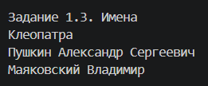
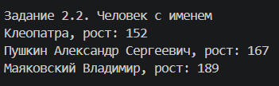
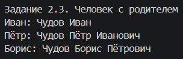
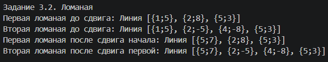
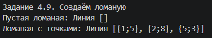
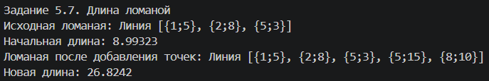

# Лабораторная работа № 3
 
**Выполнил:** Окулов Артемий  
**Вариант:** 10  
**Язык программирования:** C++

---

## Задание 1.3. Имена

### Текст задания

Создать сущность `Имя`, которая описывается тремя параметрами: фамилией, личным именем и отчеством. Имя должно приводиться к строковому виду, включающему все заданные параметры в традиционном порядке: «Фамилия Имя Отчество». Необходимо предусмотреть возможность того, что любой из параметров может быть не задан. В этом случае отсутствующий параметр не должен участвовать в формировании строки.

Создать следующие имена:

- Клеопатра;
- Пушкин Александр Сергеевич;
- Маяковский Владимир.

### Реализация

Для решения создан класс `Name`. Метод `ToString()` формирует полное имя, пропуская незаданные параметры.

### Скриншот результата выполнения

<!-- Поместите изображение в папку screenshots и назовите его task-1-3.png. -->

---

## Задание 2.2. Человек с именем

### Текст задания

Объединить сущности `Человек` из задания 1.2 и `Имя` из задания 1.3 таким образом, чтобы имя человека задавалось с использованием сущности `Имя`, а не строки.

Создать следующих людей:

- человека с именем Клеопатра и ростом 152;
- человека с именем Пушкин Александр Сергеевич и ростом 167;
- человека с именем Маяковский Владимир и ростом 189.

### Реализация

Для решения создан класс `Person`, который хранит объект класса `Name` и рост человека. Метод `ToString()` возвращает имя и рост.

### Скриншот результата выполнения

<!-- Поместите изображение в папку screenshots и назовите его task-2-2.png. -->

---

## Задание 2.3. Человек с родителем

### Текст задания

Изменить сущность `Человек` из задания 2.2, добавив возможность задавать третий параметр — отца, который также является человеком.

При приведении человека к строковой форме необходимо учитывать следующие правила:

- если у человека не задана фамилия, а у отца фамилия задана, использовать фамилию отца;
- если у человека не задано отчество, а у отца задано имя, сформировать отчество из имени отца с добавлением суффикса «ович».

Создать людей Чудова Ивана, Чудова Петра и Бориса. Сделать Ивана отцом Петра, а Петра — отцом Бориса. Вывести на экран строковое представление всех троих людей.

### Реализация

Класс `Person` хранит ссылку на отца. При формировании строки метод `GetEffectiveName()` получает имя с учётом фамилии и отчества, которые могут быть унаследованы от отца.

### Скриншот результата выполнения

<!-- Поместите изображение в папку screenshots и назовите его task-2-3.png. -->

---

## Задание 3.2. Ломаная

### Текст задания

Создать сущность `Ломаная`, представляющую собой ломаную линию. Ломаная должна содержать массив точек и приводиться к строковой форме вида «Линия [Т1, Т2, ..., ТN]», где каждая точка представлена в текстовом виде.

Необходимо выполнить следующие действия:

1. Создать первую ломаную, проходящую через точки `{1;5}`, `{2;8}`, `{5;3}`.
2. Создать вторую ломаную, у которой первая и последняя точки совпадают с первой и последней точками первой ломаной, а промежуточные точки — `{2;-5}` и `{4;-8}`.
3. Сдвинуть начало первой ломаной так, чтобы начало второй ломаной также сдвинулось.

### Реализация

Для решения используются классы `Point` и `PolylineShape`. Крайние точки двух ломаных хранятся совместно, поэтому изменение общей начальной точки первой ломаной отражается и на второй.

### Скриншот результата выполнения

<!-- Поместите изображение в папку screenshots и назовите его task-3-2.png. -->

---

## Задание 4.9. Создаём ломаную

### Текст задания

Изменить сущность `Ломаная` из задания 3.2. Предусмотреть два способа создания объекта:

- без указания каких-либо параметров;
- с указанием некоторого набора точек.

### Реализация

В классе `PolylineShape` реализованы конструктор без параметров для создания пустой ломаной и конструктор, принимающий набор точек. В программе создаются и выводятся обе ломаные.

### Скриншот результата выполнения

<!-- Поместите изображение в папку screenshots и назовите его task-4-9.png. -->

---

## Задание 5.7. Длина ломаной

### Текст задания

Изменить сущность `Ломаная` из задания 4.9. Предусмотреть возможность добавления новых точек к уже имеющимся точкам. Добавление должно приводить к получению нового набора, содержащего как старые, так и новые точки. Также ломаная должна возвращать свою общую длину.

Необходимо выполнить следующие действия:

1. Создать ломаную, проходящую через точки `{1;5}`, `{2;8}`, `{5;3}`.
2. Вывести на экран её длину.
3. Добавить к ломаной точки `{5;15}` и `{8;10}`.
4. Повторно вывести на экран длину ломаной.

### Реализация

В классе `PolylineShape` реализованы методы `AddPoints()` для добавления точек и `Length()` для вычисления общей длины. Длина определяется как сумма расстояний между каждой парой соседних точек.

### Скриншот результата выполнения

<!-- Поместите изображение в папку screenshots и назовите его task-5-7.png. -->

